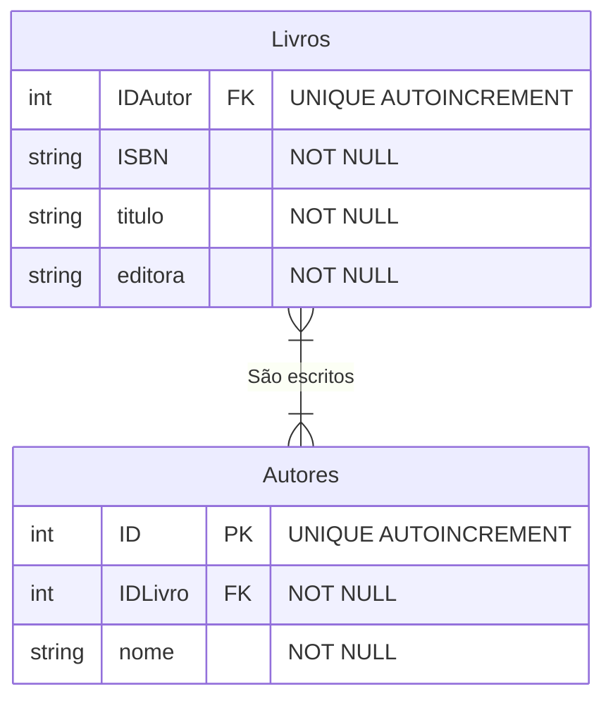
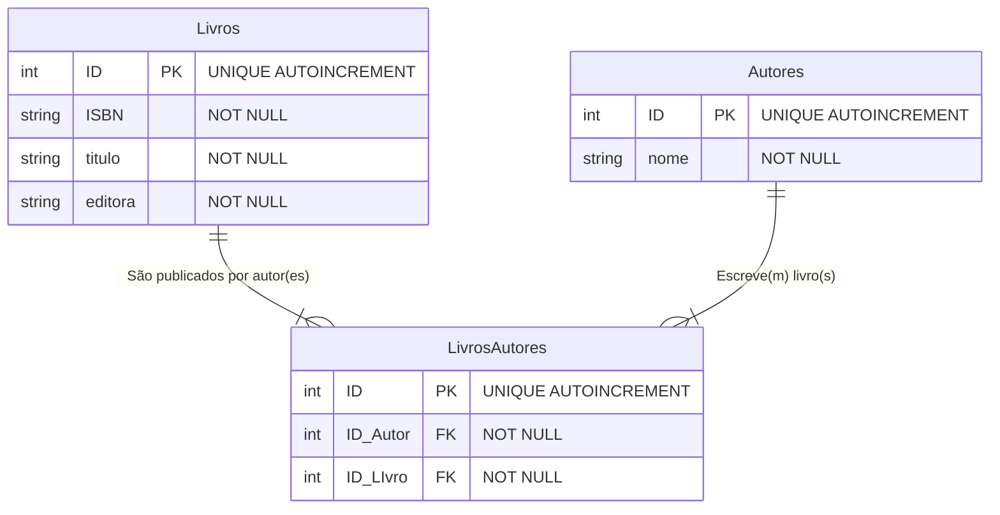

### Exercício 2: Catálogo de Livros e Autores  
#### Cenário: Um sistema de biblioteca exibe os dados assim:  
*View_Livros: ISBN, Titulo, Autores, Editora*  

_Dados: 978-85, "Banco de Dados", "C.J. Date, Abraham Silberschatz", "Pearson"_

*Tarefa: Um livro pode ser escrito por vários autores e um autor pode escrever vários livros. Crie o diagrama no Mermaid aplicando a normalização (incluindo a tabela associativa/intermediária).*  

#### Primeira solução  

#### Segunda solução - Com 3 Entidades

O **INNER JOIN** é um comando em SQL usado para combinar dados de duas ou mais tabelas com base em uma coluna em comum entre elas.

Como funciona

• Apenas correspondências: Ele retorna somente os registros que possuem um valor correspondente em ambas as tabelas.
• Exclusão de órfãos: Se uma linha existir em uma tabela, mas não tiver um par correspondente na outra, ela é ignorada e fica de fora do resultado.
• Pense na interseção: Em diagramas de Venn, o INNER JOIN representa a intersecção (a parte do meio que se sobrepõe) entre os dois conjuntos de dados.